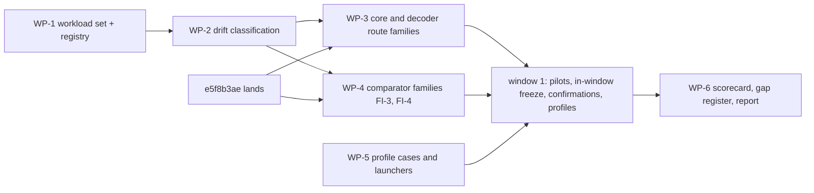

# Integrated competitive scorecard: design

> **Diátaxis Type:** Explanation

Design and execution plan of `@/issue/1362381c`, the final integrated
scorecard of epic `@/issue/1a379447` (epic REQ-05 and the aspirational REQ-07,
with REQ-01, REQ-03, REQ-04 and REQ-06 support). The
[measurement contract](../measurement-contract.md), the
[frozen protocol](../f547c394/protocol.md) version 4 with its
[amendment](../f547c394/amendment-v4.md) and the
[worker brief](../worker-brief.md) govern every step; this design adds no
protocol, schema or checker version.

## Decisions

Each item is ruled before the work package it names starts. The invoker
selected the recommended option of D-1, D-2, D-3 and D-6 on 2026-10-25; the
lead selected the recommended option of D-4 and D-5. The recommendation is the
lightest option that meets the criteria literally.

**D-1. The frozen workload set is not defined anywhere.** The epic
description and this issue's REQ-07 and REQ-12 refer to "the frozen workload
set" and "every primary cell", and no committed document lists either. Every
candidate definition is family-local (for example
[logical-buffer addendum](../2037941f-profile-and-optimize-mid-range-buffer-operations/logical-buffer-addendum.md),
"five primary cells"; [calibration plan](../63bad95d/calibration-plan.md),
"one primary workload per entry-point group").

- Option A (recommended): WP-1 freezes the set as a generated, committed
  declaration `workload-set.json` before any trial of this issue. A workload
  cell is every confirmatory or holdout cell of the latest accepted
  protocol-v4 (or, where no v4 confirmation exists, the latest accepted)
  confirmation of each family in the family registry below, plus the
  integrated families of this issue. A primary cell is a workload cell with an
  external comparator arm. Families that end at a pilot contribute their cells
  as exploratory rows, never as primary cells. The declaration states its rule
  and the registry, so it is a projection of committed addenda, not a
  hand list.
- Option B: a hand-selected subset per domain (smaller scorecard, but
  "complete" then rests on a selection the criteria do not name).

**D-2. The canonical BCH evidence is not complete.** The BCH receipt of
`@/issue/fd9d5416`
([receipt](../../../bench_results/fd9d5416/2026-10-02-fd9d5416-bch-performance-receipt.md))
is Criterion-based, outside protocol v4, and its issue is `InProgress` with
failed doc-review and research-review gates. Session 19 removed the
`1362381c → fd9d5416` edge.

- Option A (recommended): consume that receipt and its survey data
  (`dev/bench_results/4e732b56/`) by path and digest as historical context,
  labelled with the issue state; consume the protocol-v4 BCH confirmations of
  this epic (`8e53235b` codeword assembly, `6fb89a3c` generator matrix,
  `04b85d10` layout consumers, `1d4fd63d` bitslice cells) by identity; and
  remeasure the affected integrated BCH encode cells under protocol v4 in
  family FI-4.
- Option B: wait for `fd9d5416` to complete; this blocks the scorecard on
  work outside the epic.

**D-3. Which integrated cells "remeasure".** REQ-07 requires remeasuring the
affected BCH cells, and the Background asks that kernel speedups survive
production dispatch. The design reads "affected" as follows: a cell is
affected when the code text of a measured gf2 production package differs from
the producing-input snapshot its receipt pins. The rule compares content
identities, consistent with `behavioral-evidence-validity`; Git history plays
no part. Unaffected cells are consumed by identity. The alternative,
remeasuring every primary cell, needs roughly one family per six primary cells
(P-20 below) and every family harness rebuilt. That fails the lightest-approach
standing rule and gains nothing the invariant does not already grant.

The [drift record](production-drift.json) contradicts the premise of D-3: it
classifies every committed receipt whose measured content resolves as
`code-differs`, because each such receipt's measured packages carry code
changes; the rest pin no production content and are `unresolvable`. The invoker therefore ruled on
2026-10-25 that consumed cells keep their evidence by identity, each labelled
with its drift class (REQ-07 invalidates evidence only for producing
measurement-behavior changes), and that the integrated families remeasure only
what the criteria name: the BCH cells (FI-4), the core and decoder routes
(FI-1, FI-2) and the AFF3CT decoder comparison (FI-3); no family remeasures
other consumed cells.

**D-4. Several integrated families instead of one.** P-20 admits at most six
confirmatory and holdout cells per first attempt. The integrated measurement
is therefore split into families that each ask one post-integration question
on a fresh ledger. These are new questions, not renamed retries of a closed
family (protocol, ledger section). Recommended: accept.

**D-5. "Where meaningful" for core arms (REQ-08).** Recommended: core-route
cells measure one-core latency, because the core kernels run on one thread,
and each such cell records that reason in its declaration. Decoder-route and
BCH parallel-batch cells measure one core, six and twelve physical cores and
twenty-four logical CPUs.

**D-6. A BCH external arm needs harness work.** The `4e732b56` external BCH
programs (`dev/active/ae03bcd0-general-bch/4e732b56/baseline-survey/`) time
themselves and do not speak the runner's arm wire contract. FI-4 wraps them as
runner arms, as the AFF3CT arms are wrapped. Recommended: accept that scope.
The alternative records the external BCH comparison as unavailable under
protocol v4, which leaves REQ-12 without a measured BCH comparison.

## Problem statement

The epic's family surveys measured kernels and consumers one family at a
time, often before later production changes landed: the lane decoder and its
selectors (`ed3d490e`, `0a77ecfc`), worker-aware routing (`d06a99ed`),
word-wise BCH codeword assembly (`8e53235b`), the BMI2 shift route
(`f8dd4dde`) and the core profile's bit-backend selector (`63bad95d`). This
issue publishes one scorecard over the frozen workload set. Each cell either
cites a receipt that still measures current production code or is remeasured
on the current release build. Matched-algorithm and fastest
quality-compatible comparisons are reported separately, together with a
post-integration reprofile and a disposition for every material residual gap.

## Success criteria (verbatim from the issue)

- [hard] REQ-01: Satisfy the [Zen 3 measurement contract](../measurement-contract.md) for correctness, reproducible release benchmarks, comparison validity and adoption; receipts pin its committed version, the frozen protocol and the cell addendum. Include mandatory before/after evidence for production changes and preserve negative outcomes.

- [hard] REQ-07: Publish raw samples, a per-cell scorecard and reproducible report for the complete frozen workload set. Identify source/input/toolchain/hardware provenance, selected paths, latency, throughput, memory, scaling and uncertainty. Consume completed canonical BCH evidence by identity, then remeasure affected integrated BCH cells under this protocol; preserve historical evidence and invalidate it only for producing measurement-behavior changes.

- [hard] REQ-08: Run independent confirmation after integration for both core and decoder-specific tuned production routes, with one-core, physical-core and SMT configurations where meaningful. Report batch-fill latency separately from throughput. Compare matched-algorithm and fastest quality-compatible measured arms per cell; do not designate a surveyed project the winner or hide losses in an aggregate.

- [hard] REQ-09: Reprofile the integrated bottlenecks and account for allocation, instruction/dependency limits, compiler spills, packing, cache traffic, bandwidth and orchestration. State the measured basis for any claimed approach to a hardware limit.

- [hard] REQ-10: Give every gap exceeding the frozen material-gap threshold a recorded measured limit, preserved negative/inconclusive experiment, or concrete tracked follow-up with its next falsifiable experiment. Apply the predeclared search/stop budget; do not claim an absolute maximum from a finite search or endlessly retune against confirmation samples.

- [hard] REQ-11: Publish BER/FER sample counts and confidence intervals for decoder validation, and separate any schedule/precision differences from matched runs. Demonstrate the declared deterministic contract across batching, worker counts, fallback and resume.

- [hard] REQ-12: Report the outcome of the aspirational fastest-open-source target for every primary cell, including losses and unavailable equivalent comparisons, with source citations and no substitution of an unrelated metric.

## Inventory and gaps per criterion

### Family registry

The registry is the family list WP-1 projects into `workload-set.json`. Each
family's receipts, ledgers and generated tables sit under
`dev/bench_results/<issue>/` and the record directory of its owning issue.

| Domain | Families (owning issue) | External arms measured |
|---|---|---|
| LDPC decode | `ldpc-update-*` (`07ca8585`); `ldpc-steady-*` (`3be770d5`); `ldpc-matched-algorithm-alist-v1`, `ldpc-quality-compatible-alist-v1` (`c077a88b`); `ldpc-batch-*` (`ed3d490e` children); `d06a99ed-worker-aware-production-v1`; `ldpc-qc-*` (`f63a2464`) | AFF3CT [Cassagne2019] |
| NR encode, de-rate matching | `nr-rate-matched-encode-baselines-v1` (`12fdeb5b`); `nr-llr-derate-matching-baselines` (`eda07788`) | srsRAN [Srsran2026], AFF3CT |
| DVB-T2 interleave | `dvb-t2-bit-interleave-baselines` (`eda07788`); `dvb-t2-interleave-consumer-profile` (`9fb40c83`) | xdsopl [Xdsopl2026] |
| BCH | `8e53235b-bch-codeword-assembly`; `bch-genmatrix-consumer` (`6fb89a3c`); BCH cells of `bit-storage-layout-consumers` (`04b85d10`) and `transpose-lane-selection` (`1d4fd63d`); `fd9d5416` receipt (D-2) | M4RI [AlbrechtBard2026]; AFF3CT and bchlib in `4e732b56` only |
| Popcount | `popcount-baselines`, `and-popcnt-baselines` (`26465e6c`); `popcount-route-selection`, `fused-count-consumers` (`5cbb6545`) | libpopcnt [Libpopcnt2026], Muła [Mula2018] |
| Polynomial / CLMUL | `polynomial-*` (`c7113c5a`); `wide-polynomial-competitiveness`, `gf2m-clmul-crossover` (`53c5a8c0`); `ymm-clmul-dispatch` (`1d0da41f`); `public-clmul-wide-dispatch` (`1c602857`) | gf2x [GfTwoX2026] |
| Transpose | `transpose-lane-*` (`1d4fd63d`); `transpose-vs-external` (`6fb89a3c`) | M4RI, Bitshuffle [Bitshuffle2026] |
| Logical buffers, matvec | `2037941f-*` families; `logical-buffer-vs-isal` (`6fb89a3c`); `4337c02e-matvec-simd-threshold`; `63bad95d-*-matvec-vs-m4ri`; `7dbe1393-*` | ISA-L [IsaL2026], M4RI |
| $\mathrm{GF}(2^8)$ | `byte-field-*` (`6c6b09b1`); `bytefield-consumer-*` (`19513245`); `gf256-shipped-*` (`4c1e441f`, `ad2a6a58`) | ISA-L, GF-Complete [GfComplete2026], M4RIE [Mfourrie2026] |
| Core route and builds | `63bad95d-native-ladder(-v2)`, `63bad95d-profile-dispatch-overhead-v2`; `bitvec-residual-bmi2-route` (`00dd43c3`); `caller-trusted-entry-check-cost` (`bfc2ceab`) | none (build or before/after arms) |

Comparators recorded as unavailable keep their records:
OpenAirInterface [OpenAirInterface2026] ([comparator survey](../c077a88b/findings.md)),
srsRAN LDPC decode and rate dematching
([comparator survey](../c077a88b/findings.md), [eda07788 findings](../eda07788/findings.md)),
and the AFF3CT flooding SIMD modes
([decoder outcome record](../6230e0b6/findings.md)).

### Criterion inventory

| Criterion | What exists | Gap this issue closes |
|---|---|---|
| REQ-01 | Every family receipt pins contract, protocol and addendum (P-02, P-03). Before/after evidence for each production change is in its owning issue (`d06a99ed` outcome, `8e53235b`, `00dd43c3`, `63bad95d` F-09). [Receipt re-evaluation](../a203a23c/receipt-reevaluation.json) records fresh-checkout verdicts. | New integrated families with frozen addenda and pilot-derived resolution. A scorecard row per cell with its receipt pins and preserved outcome. |
| REQ-07 | Raw samples per receipt. Per-domain generated tables (e.g. [LDPC tables](../../../bench_results/ed3d490e/tables.md), `make-outcome-tables.py`). | No cross-family scorecard, no workload-set declaration (D-1), no drift classification of consumed cells (D-3), and no protocol-v4 integrated BCH cells (D-2). |
| REQ-08 | Pre-integration holdouts: core (`63bad95d-profile-dispatch-overhead-v2`, one core) and decoder (`ldpc-batch-decode-selector-holdout-v1`, one worker, [outcome](../7695aaee/outcome.md)), both measured before `d06a99ed`. Batch fill is measured as a zero-iteration stage probe in the gf2 decoder arms. | Post-integration holdout confirmation of both routes, with physical-core and SMT arms for the decoder. Batch-fill latency as its own scorecard column. Matched and fastest columns per primary cell. |
| REQ-09 | Decoder profile series ([`f434ddd3` profile](../../../bench_results/f434ddd3/profile/profile.md)); 3be770d5 steady profile; 2037941f logical and dense profiles; c04dd4ac shift and interleave profiles; committed assembly listings. | Reprofile of the integrated decoder route (worker-aware routing changes the multicore route). Attribution of every primary cell with a material gap that no profile of its current code covers. A per-mechanism accounting table. |
| REQ-10 | Per-family residual-gap sections, e.g. [mid-range residual gaps](../2037941f-profile-and-optimize-mid-range-buffer-operations/mid-range-findings.md#residual-gaps) and R-01…R-05 of the [decoder record](../6230e0b6/findings.md#residual-gaps-and-their-limits). Each family freezes its `material_gap_threshold` and `search_budget`. | One gap register over all primary cells, each material gap mapped to a measured limit, a preserved experiment or a tracked issue with its next falsifiable experiment, and the budget spent. |
| REQ-11 | Decoder receipts carry per-frame errors, FER/BER points and frame-Hoeffding/Wilson intervals (P-18). Determinism tests: `ldpc_batch_contract.rs`, `batch_decode_worker_determinism.rs`, `pooled_batch_decoder.rs`, checkpoint tests in `checkpoint_compat.rs`. | Projection of the quality columns into the scorecard, with matched and fastest rows kept apart. A committed untimed verification record of the determinism suites on the integrated tree. |
| REQ-12 | Per-family aspirational statements, e.g. [performance evidence](../../../../docs/reference/performance-evidence.md) and the `fd9d5416` W1/W2 table. | Target outcome per primary cell (met, not met, inconclusive, unavailable), each with its comparator citation key. |

### Dispositions of pitfalls and tasks that name this issue

| Item | Disposition |
|---|---|
| surfaced pitfall 7: the P-20 bound | Folded in: every integrated family is sized by it (below). Not-confirmatory families (`1d0da41f` v3, `26465e6c` v3 popcount, `6fb89a3c` logical/transpose, `eda07788` DVB v3, `c7113c5a` baselines) enter the scorecard as `not-confirmatory` rows with that reason. |
| surfaced pitfall 34: comparator-gap outcome inversion | Folded in: the scorecard reads comparator-gap outcomes through the `INTERPRETATION` map of `make-collection-outcome.py`, extended at its source where a family's arm order differs. |
| surfaced pitfall 50: no zero-window runner mode | Resolved: the shared `benchmark-ab-runner smoke` (`@/issue/d45aff82`) answers the validation position with one untimed dispatch; WP-3 and WP-4 use it. |
| surfaced pitfall 83: AFF3CT INTRA at half LLR scale | Outside any criterion of this issue: bug `@/issue/11bfbfd9` tracks it outside the epic. The scorecard reports the arm as not quality-compatible on the recorded corpus, as recorded. |
| `12fdeb5b` NR encoder baselines | Resolved, done: consumed by identity with its drift class. |
| `bdc507a3` resumable P-11 | Resolved by protocol v4; integrated campaigns resume under it. |
| `428f2f6b` hand-copied numbers | Resolved; the scorecard copies no figure into prose. |
| `a387825e` lock leak | Resolved on main; the window runner also replaces lock-holding compiler-cache servers. |
| `3e59cb9a` DVB warm pass | Resolved; the repaired v3 receipt is exploratory history and enters as such. |
| `a203a23c`, `7cdc28e9` fresh-checkout verdicts | Resolved; WP-6 reruns `reevaluate-receipts.sh` to show every consumed receipt reproduces its verdict. |
| `2c487595` schema siblings | Resolved; schema siblings exist per version. |
| `706a8f93` achieved priority | Outside any criterion: rejected under the provenance freeze. The scorecard states the host facts receipts observe and nothing more. |
| `94bbe5d7` freezer prose | Outside any criterion: rejected. Every in-window freeze passes `--family-description` (worker brief). |
| `8275a6f8` child diagnostics | Resolved on main. |

## Integrated measurement plan

### Families

Each new family has its own fresh ledger (genesis file committed with the
pilot addendum) and runs pilot → canonical freeze → confirmation. All arms are
release builds of the current tree, built in-session before the window.

| Family | Purpose | Question | Arms | Cells (C + H ≤ 6) |
|---|---|---|---|---|
| FI-1 `1362381c-core-route-integration` | `final-integration` | Does the committed core envelope hold on the integrated tree: tuned-portable no worse than, or better than, conservative-portable, and native no worse than tuned-portable? | `63bad95d` profile harness build levels, through its `planned-families.json` / `make-family-addenda.py` / `make-family-plan.py` (extended at source for a new family entry) | Confirmatory: workloads of the `63bad95d` families. Holdout: workload-set entries that no `63bad95d` pilot measured (declaration committed before the pilot). One core (D-5). |
| FI-2 `1362381c-decoder-route-integration` | `final-integration` | Does the committed coding envelope with worker-aware routing decode no slower than the conservative selectors at every worker configuration? | tuned-portable tuned-profile arm against the conservative-portable single-frame arm, rebuilt after `e5f8b3ae`; `make-family.py` declaration under `survey/families/` with `holdout_declaration` | Both codes, one worker at full and one-frame waves, plus six and twelve physical cores and twenty-four logical CPUs; holdout cells from batch sizes and seeds absent from the calibration inventory. |
| FI-3 `1362381c-ldpc-aff3ct-integration` | `decoder-family`, `comparator-gap` | Is the integrated production route materially slower than AFF3CT's matched flooding NMS decoder? | production gf2 arm under the committed envelope; pinned AFF3CT matched arm; `make-family.py` | Both codes at one worker, full wave and one frame, plus twelve physical cores. Matched-algorithm only: the fastest-compatible pilot admitted no AFF3CT mode as quality-compatible, so that comparison is consumed by identity. |
| FI-4 `1362381c-bch-integration` | `consumer-family`, `comparator-gap` | Is gf2's production BCH batch encode materially slower than the strongest external arm of the `4e732b56` survey on its workloads? | production gf2 BCH encode (the `8e53235b` harness); AFF3CT and bchlib programs wrapped as runner arms (D-6) | One cell per survey code class that `8e53235b` changed (m14 and the DVB-T2 short and normal codes), at the batch sizes of the `fd9d5416` W1 table; one core, plus a parallel batch cell at six physical cores if the arm exposes workers. |

Each family freezes its own `material_gap_threshold`, margins and
`search_budget` in the pilot addendum committed before the window, with a
rationale tied to its pilot resolution. The freezer refuses margins that do
not exceed one plus the resolution.

### P-20 bound arithmetic

`receipt::tail_supported` requires
$B\,\alpha_c/2 \ge 20$ with $B = 10\,000$ (`MIN_TAIL_DRAWS`,
`bootstrap_resamples`). `trial_ledger::attempt_budget` gives attempt $t$ the
share $\alpha_t = \alpha/[t(t+1)]$ with $\alpha = 0.05$, counting only
reservations that spend comparisons, and the Bonferroni divisor $m$ counts
every confirmatory and holdout cell the chain holds through this attempt:

$$
\alpha_c = \frac{\alpha_t}{m}, \qquad
\frac{B}{2}\cdot\frac{\alpha_t}{m} \ge 20 \iff m \le \frac{B\,\alpha_t}{40}.
$$

On a fresh ledger ($t = 1$, no prior comparisons) $\alpha_1 = 0.025$ and
$m \le 6.25$, so each FI family admits six confirmatory and holdout cells.
Pilots are exploratory and spend nothing. A second attempt on the same ledger
($t = 2$, $\alpha_2 = 0.05/6$) admits $m \le 2.08$ cumulatively, so after a
six-cell first attempt it admits no cell: each FI family has exactly one
confirmatory attempt. Before each freeze, the launcher prints
`benchmark-acceptance --next-attempt <ledger> <family>` into the job output,
and the freezer's cell selection stays within `max_cells`.

### Sequencing and windows

1. In session: WP-1 and WP-2 commit the workload-set declaration and the
   drift record. WP-3 and WP-4 build arms after `e5f8b3ae` merges, smoke every
   arm through `benchmark-ab-runner smoke`, and commit pilot addenda, ledger
   genesis files, holdout declarations, plans and the FI declarations' margins.
   Every holdout declaration is committed before its pilot.
2. Window 1: one launcher per family, modelled on
   [`d06a99ed/measurement/window.sh`](../d06a99ed/measurement/window.sh). It
   runs the pilot, freezes with the canonical freezer
   (`c7113c5a/survey/freeze-confirmation.py`, with repository-relative
   `--pilot`, `--family-description`, `--purpose final-integration` and
   `--holdout-cells` where applicable), commits only the freeze outputs, and
   runs the confirmation. The profile series follow the campaigns.
3. Window 2 is a reserve. It resumes an interrupted campaign under its own
   identity, or runs a voided-attempt replacement (amendment-v4 rule) after a
   procedural freeze or launch defect. It never repeats a confirmation whose
   results were read.

Estimated window load is a queue estimate, not a measurement: the
`d06a99ed` pilot-plus-confirmation job (six decoder cells) is the per-family
reference in `bench-window/queue.tsv`, and each job line states its own
estimate.

## Reprofiling plan (REQ-09)

- **Decoder route.** A new case file runs the integrated production route,
  under the committed envelope with worker-aware routing, at one, six and
  twelve physical cores and twenty-four logical CPUs on both codes. It runs
  through [`run-profile.sh`](../../../bench_results/ed3d490e/run-profile.sh)
  (`2a3b479d`) with a build record of the rebuilt `ldpc-batch-profile`, and
  is summarized by `3be770d5/survey/summarize-profile.py`. Its
  `RULES_BY_EXECUTABLE` gains the new executable's digest at its source. The
  `f434ddd3` series is consumed by identity for the lane cases that did not
  change.
- **Other integrated bottlenecks.** Every primary cell with a material gap
  needs a profile of the code it measures. If an existing profile covers that
  code unchanged (WP-2 classification), the cell cites it: the 2037941f
  logical and dense profiles, the c04dd4ac shift and interleave profiles, the
  3be770d5 steady profile. Each remaining cell gets a launcher that sources
  the shared session loop `3be770d5/survey/profile-series.sh` with its own
  `series_cases`, so no new session framework is written. Expected subjects
  are the NR encoder against srsRAN (if no current profile covers it) and FI-4
  BCH encode.
- **Accounting table**, generated in WP-6 per profiled cell:
  - allocation: the `69dd39f1` allocation witnesses, an untimed in-session test
    run on the integrated tree;
  - instruction and dependency limits: perf counters and the committed
    assembly listings, e.g. `ldpc_lanes.asm.txt`;
  - compiler spills: stack traffic in those listings, through the existing
    `make-asm-comparison.py` tools;
  - packing and conversion: stage probes and whole-consumer adapter stages;
  - cache traffic and bandwidth: counter ratios;
  - orchestration: worker scaling rows.

  A mechanism the evidence does not measure is stated as unmeasured. No
  approach to a hardware limit is claimed unless a counter or bytes-per-second
  measurement against a measured host bound supports it, and the row names
  that basis.

## Scorecard and report generator (REQ-07, REQ-12)

- One committed generator,
  `dev/active/1a379447-zen3-cpu-performance/1362381c/survey/make-scorecard.py`,
  reads `workload-set.json`, the drift record, the gap register and the
  committed receipts it names. Its outputs are
  `dev/bench_results/1362381c/scorecard.json` and `scorecard.md`.
- It verifies each campaign's execution log through
  `dev/scripts/verify-campaign-log.py`. It reads outcomes through
  `make-collection-outcome.py` and enumerates receipts through
  `a203a23c/select-receipts.py`; both are imported, never copied.
- It writes one row per workload cell with these columns:
  - family, cell and role;
  - receipt path and digest, labelled `consumed` or `integrated`;
  - provenance from the receipt: producing-input digest, toolchain, host
    observation;
  - selected path (`selected_path` where the arm reports it);
  - per-call latency and throughput derived from the per-execution medians,
    with the workload size;
  - memory (peak resident set or lane workspace where recorded, otherwise
    `not recorded`);
  - scaling and core arm;
  - interval, corrected alpha and pairs;
  - decision and outcome as recorded, read through the comparator-gap
    inversion;
  - comparator kind (`matched-algorithm` / `fastest-quality-compatible` /
    `whole-consumer` / `kernel-isolated`);
  - batch-fill latency as its own column;
  - FER/BER sample counts and intervals for decoder cells;
  - aspirational target outcome (`met`, `not met`, `inconclusive`,
    `unavailable` with the record that says so) with the comparator's
    citation key.
- No aggregate row exists. Losses stay per cell. No project is named winner.
- The gap register `gaps.json` (input, committed) maps each primary cell whose
  outcome records a material gap to one disposition: a measured-limit pointer,
  a preserved-experiment pointer, or a tracked issue with its next falsifiable
  experiment and the family's spent search budget. The generator refuses to
  write when a material-gap cell has no entry. That refusal belongs to the
  scorecard's output semantics; it adds no checker version.
- Reproducibility: two consecutive runs followed by `git diff --exit-code`.
  The report `1362381c/findings.md` (Research) states conclusions with
  pointers only.
- `docs/reference/performance-evidence.md` gains claim entries only for
  confirmatory integrated cells, in its existing format.

## Work packages

| WP | Goal | Files | Inputs | Untimed verification | Queue lines |
|---|---|---|---|---|---|
| WP-1 | Freeze the workload set (D-1) and the family registry | `1362381c/survey/make-workload-set.py`, `1362381c/workload-set.json` | committed addenda and acceptance summaries | generator self-test; byte-stable rerun | none |
| WP-2 | Classify consumed cells as affected or unaffected (D-3) | extend `6e87c436/survey/make-production-drift.py` at its source to take any receipt; `1362381c/production-drift.json` | receipts' `inputs/` snapshots, current tree | rerun identical | none |
| WP-3 | Core and decoder route integration families FI-1, FI-2 | `63bad95d/survey/planned-families.json` entry and its generators; `ed3d490e-zen3-ldpc-frame-simd/survey/families/1362381c-decoder-route.json`; holdout declarations; ledgers; launchers | WP-1; `e5f8b3ae` merged | arm builds at Rust 1.95; `benchmark-ab-runner smoke`; untimed staged runs | two (pilot → freeze → confirmation each) |
| WP-4 | Comparator integration families FI-3, FI-4 | FI-3 declaration under `survey/families/`; BCH arm wrappers beside the `8e53235b` harness; per-family addenda and launchers | WP-1, WP-2; `e5f8b3ae` merged | bit-exact equivalence gates; smoke | one per family |
| WP-5 | Reprofile cases and launchers | decoder case file and build record; `RULES_BY_EXECUTABLE` entry; launchers over `profile-series.sh` for the other subjects | WP-2, WP-3 builds | dry session (outputs are not evidence); allocation witnesses | one per series |
| WP-6 | Scorecard, gap register, report, determinism record, publication | `make-scorecard.py`, `gaps.json`, `dev/bench_results/1362381c/*`, `1362381c/findings.md`, `performance-evidence.md` entries | window outputs, WP-1/2 | byte-reproducible double run; `reevaluate-receipts.sh`; determinism suites through `./scripts/cargo-budget.sh --test`; `./scripts/cargo-ci.sh` | none |

WP-1 and WP-2 run in parallel. WP-3, WP-4 and WP-5 run in parallel after them
and after `e5f8b3ae`. Their pilot addenda, holdout declarations, ledger
genesis files and margins are frozen and committed before window 1. WP-6
follows the window. Every package commits evidence before prose and lists its
queue lines in its report.

## Risks and open questions

- A consumed cell is a historical row labelled with its drift class; the
  scorecard never presents a `code-differs` row as a measurement of the
  current tree.
- A host disturbance during window 1 cannot be repaired by a second attempt
  (P-20, $t = 2$). It is recorded as in the `63bad95d` disturbance record. A
  repeat needs an invoker ruling like F-08 of
  [campaign findings](../63bad95d/campaign-findings.md).
- bchlib has no citation key in the issue's `cites:` labels; FI-4 needs a
  registry key before the report cites it.
- `e5f8b3ae` changes the gf2 arm digests; FI-2 and FI-3 build only after it
  merges, and story receipts keep the digests they pin.
- Ledger paths of `12fdeb5b` and `eda07788` addenda name `dev/active/<id>/`,
  while the files live under this epic's record directory. The scorecard
  resolves each ledger through the receipt's pinned prefix (P-22), never
  through the addendum path.
