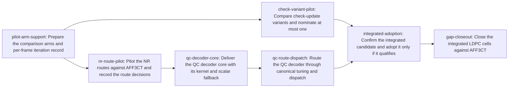

# Plan: Close the integrated LDPC gaps against AFF3CT (55c3e433)

> Planning node: c39b9e1b. [breakdown.json](breakdown.json) is the
> creation-time manifest and preregistration, kept as written. The current
> criteria are the issue descriptions, cited as `@/issue/<short-id>`; they
> include amendments after creation, and a conflict between a manifest copy and
> an issue description resolves to the issue.

## Outcome and criterion approach

| Criterion | Approach | Evidence / open gap |
|---|---|---|
| REQ-01 | One exploratory family on the existing tools, with a post-timing iteration record. | `arm-support`, `nr-pilot-frame`; [investigation](investigation.md), Harness reuse |
| REQ-02 | Two cumulative scalar variants of one function, each in a pinned build, in one exploratory family. | `check-variants`; [investigation](investigation.md), Check-update path |
| REQ-03 | A rule fixed before the run decides. Two planned delivery items run on go and close as obsolete on no-go. | `qc-go-rule`, `adoption-family` |
| REQ-04 | The pilot's decision record decides it, with no implementation unless it starts the candidates. | `nr-route-pilot` |
| REQ-05 | Each gf2 terminal states the contract; variants compare bits against an unchanged build. | `docs/reference/ldpc-decoder-numerical-contract.md` |
| REQ-06, REQ-07 | A six-row generated outcome. A pilot and freeze run for an adopted change, and a confirmation only in an owner-armed window, as `@/issue/5f401907` states. | `adoption-family`, `comparator-family` |

## Shared architectural contracts

### `arm-support` [plan-fixed] — arm identity and iteration evidence

Arms are `gf2-batch-single-frame` (forced `SingleFrame`), the tuned production arm, the QC prototype arm, and the AFF3CT flooding arm. A pre-change or variant executable is a distinct catalogue name whose build record has its own `build_root`, which `make-family.py` already resolves per arm name.

Timed frames repeat a fixed prefix, so the iteration record covers each worker and frame of that prefix. gf2 and QC counts are read from their outcomes after timing and labelled direct; the QC arm's existing store remains part of its measured operation. AFF3CT's timed clones have no counter, so its counts come from replaying the prefix on the counting prototype after timing, are labelled replay-derived, and require equal decisions. The record uses the runner's existing journal and adds no schema.

### `nr-pilot-frame` [plan-fixed] — NR pilot cells and budget

The family is `55c3e433-nr-route-pilot`, on its own ledger, exploratory, twelve pairs per cell, with at most one timed campaign. An attempt voided for a procedural defect under the protocol does not count.

Configurations are `w1-b1`, `w1-b8`, `p6-b8`, `p12-b8` and `l24-b8`, resolved by the existing `physical-cores-6`, `physical-cores-12` and `logical-cpus-24` sets, which need `--full-host`. Workload, NMS factor 0.75, cap 50, stopping, timed prefix and timing boundary stay those of `1362381c-ldpc-aff3ct-integration`.

Cells pair the single-frame arm with QC and with AFF3CT at each configuration, ten in all. QC against AFF3CT is the ratio of the two pairings and is labelled indirect.

### `check-variants` [plan-fixed] — check-update variants, isolation and nomination

`cached-signed` computes $\alpha(+1 \cdot m)$ and $\alpha(-1 \cdot m)$ once per check for both minima and selects among them, which keeps the contract's written operation order. `select-reduced` adds comparison/select reduction to `cached-signed`, keeping strict ties, skipped NaN magnitudes, infinity initialization and comparison signs.

Each variant is a patch of `min_sum_check_row` kept in the artifact directory and built as its own arm from an otherwise unchanged tree. No runtime selector exists. `ldpc_batch_contract.rs` compares two routes sharing the replacement, so posterior equality is checked across executables against the unchanged build.

The family is `55c3e433-check-variants`, on its own ledger, exploratory, twelve pairs, with at most one timed campaign. Cells pair unchanged production with each variant at `w1-b1` and `p12-b8` on both codes, eight in all.

A nomination is exploratory. A variant is eligible when its bits match, its speedup lower bound clears $1/1.1$ on all four cells, and its lower bound reaches the 1.1 improvement margin on at least one cell. Among eligible variants, the larger smallest lower bound is nominated. The margin's rationale is that the change costs one scalar function and no dispatch, so a repeatable ten percent repays it.

### `qc-go-rule` [plan-fixed] — exploratory QC decision and delivery obligations

The decision is exploratory: it starts delivery, and `adoption-family` decides adoption. It is go when all of these hold, and no-go otherwise.

- The bit and graph checks pass on the current tree.
- At `w1-b1` and `p12-b8`, QC's speedup lower bound over the single-frame arm reaches 1.25, FI-3's material-gap threshold, which reflects the delivery's size of an estimated 600 to 1,200 lines.
- At those cells, the indirect ratio of AFF3CT time to QC time is at least $1/1.1$.

Delivery obligations are carried by `qc-decoder-core` and `qc-route-dispatch`. On no-go both are rejected as `resolution:obsolete`, which satisfies their dependents.

The selection predicate is fixed now, before any measurement. It takes the QC route when the algorithm is `DecoderAlgorithm::NormalizedMinSum`, the code carries attached QC structure of NR BG1 Z=384, and the case is one worker with one frame or twelve workers with eight frames per worker. The route falls back to scalar where the kernel is unavailable. Every other case keeps its existing route, including one worker with eight frames, whose lanes own the existing lead. The predicate has no measured threshold, so it is no calibrated selector and needs no holdout.

### `adoption-family` [plan-fixed] — confirmation against pre-change production

The family is `55c3e433-integrated-adoption`, purpose `decoder-family`, on its own ledger. It asks whether the named change improves production, a question no earlier family asks. The stages are one twelve-pair pilot, a freeze by `experiments/aff3ct-ldpc-gaps/freeze-confirmation.py` with resolution from that pilot, and one 24-pair confirmation of six cells, the most a first attempt's tail support admits.

The baseline is a pinned pre-change arm, and the candidate carries the nominated variant, the delivered route, or both. Cells are both codes at `w1-b1`, `w1-b8` and `p12-b8`, with the tuned envelope on both sides.

The family declares one worthwhile speedup and equivalence 1.1. The worthwhile speedup is 1.25 for a candidate carrying QC, with the delivery-size rationale of `qc-go-rule`, and 1.1 for a variant alone. The freezer refuses margins not above one plus resolution. Losing cells the candidate targets carry objective `improvement` and all other cells `non-regression`. A candidate qualifies only when the canonical evaluator's receipt reports `qualifies` true and the conformance suites pass. The frozen complexity budget is `max_new_unsafe_kernels` 1 and `max_added_source_lines` 1,500 for QC, the investigation's upper estimate plus a quarter, and 0 and 150 for a variant, which edits one scalar function. A combined candidate sums them. An inconclusive or failed result leaves production unchanged, with one attempt per candidate.

Project-level final integration stays with the `1362381c` scorecard, so this family declares no holdout.

### `comparator-family` [plan-fixed] — confirmed gap of the adopted route

With an adopted change, `55c3e433-adopted-vs-aff3ct` measures the gap of that named route against AFF3CT, using FI-3's six cells, tuned arm, ratio direction and margins, through a same-family pilot and freeze, and one confirmation only in an owner-armed window; without one, no losing cell reports a confirmed result (`@/issue/5f401907`, REQ-01). With none, FI-3 and the preserved experiments are the results, and no campaign runs.

The boundary is the named adopted route, which FI-3 could not measure. Earlier comparator questions on changed production have each held their own family, as `ldpc-matched-algorithm-alist-v1`, `ldpc-steady-matched-single-worker-v1`, `ldpc-batch-aff3ct-matched-v1` and FI-3 show. FI-3's ledger cannot serve it: its AFF3CT candidate holds that ledger's reservation, and a second attempt there has too little alpha to pass tail support on six cells. The declaration cites FI-3 as history. Tables reuse `dev/tools/tuning-campaign-support/src/bin/benchmark-acceptance.rs`.

## Generated decomposition overview

<!-- jit:breakdown-overview:begin -->
| Key | Title | Type | Outcome | Contracts | Sources | Footprint | Landing | Depends on |
|---|---|---|---|---|---|---|---|---|
| pilot-arm-support | Prepare the comparison arms and per-frame iteration record | task | Arms and per-frame iteration record ready for one comparison family | arm-support | REQ-01, INV-harness | touches 8 | — | — |
| nr-route-pilot | Pilot the NR routes against AFF3CT and record the route decisions | task | NR pilot receipt with iterations, plus recorded QC and compact-lane decisions | arm-support, nr-pilot-frame, qc-go-rule | REQ-01, REQ-03, REQ-04, REQ-05, INV-harness | creates 2 | — | pilot-arm-support |
| check-variant-pilot | Compare check-update variants and nominate at most one | task | Two check-update variants compared on four cells, nominating at most one | arm-support, check-variants | REQ-02, REQ-05, INV-check-path | creates 2, touches 1 | — | pilot-arm-support |
| qc-decoder-core | Deliver the QC decoder core with its kernel and scalar fallback | task | Reusable QC decoder over a safe kernel with scalar fallback, matching canonical posteriors | qc-go-rule | REQ-03, REQ-05, INV-go-path | creates 2, touches 3 | — | nr-route-pilot |
| qc-route-dispatch | Route the QC decoder through canonical tuning and dispatch | task | QC route selectable through canonical tuning with tested fallback | qc-go-rule | REQ-03, REQ-05, INV-go-path | creates 1, touches 7 | — | qc-decoder-core |
| integrated-adoption | Confirm the integrated candidate and adopt it only if it qualifies | task | Candidate confirmed against pre-change production; adopted only if it qualifies | arm-support, adoption-family | REQ-02, REQ-03, REQ-05, INV-closeout | creates 2, touches 4 | — | check-variant-pilot, qc-route-dispatch |
| gap-closeout | Close the integrated LDPC cells against AFF3CT | task | Each losing cell has a recorded terminal result; eight-frame cells are reported | arm-support, comparator-family | REQ-03, REQ-05, REQ-06, REQ-07, INV-closeout | creates 2, touches 1 | — | integrated-adoption |

<!-- jit:breakdown-overview:end -->

## Material risks and owner decisions

| Risk / decision | Resolution and rationale |
|---|---|
| Issue count | Seven items, two of them go-only, is the smallest graph meeting the one-outcome sizing rule. |
| QC delivery planned before the decision | Chosen: two reviewed go-only items, rejected on no-go. Rejected: creating them after the decision, which leaves REQ-03's hard branch outside the reviewed graph. |
| Family boundary for the comparator | Chosen: a family per adopted route, per precedent. Rejected: a protocol amendment to extend FI-3's spent budget, which changes rules for all families. The owner may overrule this at review. |
| Eight-frame one-worker QC | Unmeasured against lanes because the route stays out of the predicate. The decision record may start a follow-up. |
| Vector-across-checks and variable-major layout | Excluded from REQ-02's arms to bound the search: they need unsafe kernels or a storage change. If DVB-T2 stays behind, the closeout records the negative result. |
| DVB-T2 may stay behind | Estimated gain from halving check cost is 1.6–1.7× against a 1.97× gap, so REQ-07 may not be met. REQ-06 accepts the recorded outcome. |
| QC prototype on the current tree | On `7d21df9ae`, `cargo check --locked --release --all-targets` passes for the prototype and arm crates. Behavioral conformance stays a pre-timing check. |
| Timed work | Estimated allowance is 25 minutes per pilot family and 15 minutes per confirming family. Each is a queue line of the form in the investigation; arming needs the owner's approval. |
| Criterion readings | REQ-01's "production single-frame route" reads as forced `SingleFrame`, and its "every timed frame" as the repeated prefix. No criterion changes. |

## Investigation sources

- [Investigation](investigation.md) holds the claim classification, reuse paths and go-path findings. Manifest source aliases map to its sections: `INV-harness` to Harness reuse, `INV-check-path` to Check-update path, `INV-go-path` to Go path, and `INV-closeout` to Closeout.
- [aff3ct-gap-investigation.md](aff3ct-gap-investigation.md) holds the candidate ranking.
- FI-3's values are in `dev/active/1a379447-zen3-cpu-performance/1358d6ab/outcome.md` at revision `46bdf2114`, the last revision that tracks it (`git show 46bdf2114:<path>`).
