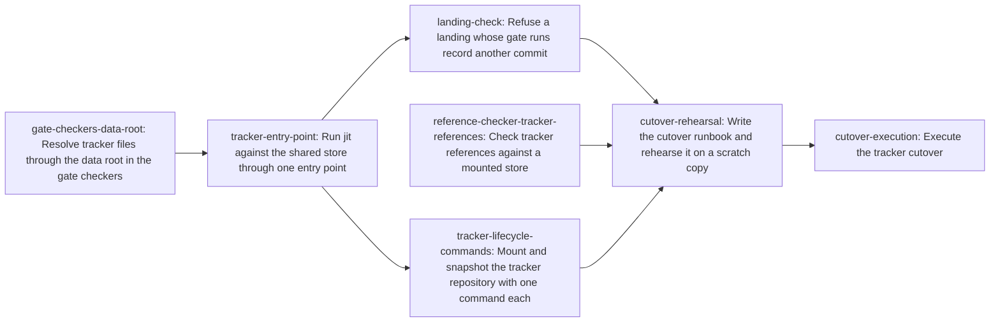

# Plan: Move the tracker data into its own repository (6ba9be17)

> Planning node: aa67438d. Authoritative graph:
> [breakdown.json](breakdown.json).

## Outcome and criterion approach

The tracker becomes an independent git repository checked out at `.jit/` of
the primary checkout. The code repository ignores that path. Every checkout
on the host reads and writes the one store, so tracker state stops being
branch content.

| Criterion | Approach | Evidence / open gap |
|---|---|---|
| REQ-01 | The cutover commit removes the tracker paths from the index, ignores `/.jit/` and forbids tracked paths under it in the budget configuration | F-01, D-08 |
| REQ-02 | The tracker repository is extracted with the history of its paths and mounted unedited; equality is the git tree identifier of `.jit` against the new head tree | D-10 |
| REQ-03 | One entry point resolves the store, the code root and the agent identity from git; the cutover observes a gate from a linked worktree | `tracker-root-resolution`, F-02, F-04, F-07 |
| REQ-04 | A landing check compares the commit of each required gate's executed run with the branch tip | `landing-link`, F-03, F-08, F-24 |
| REQ-05 | Invariant identifiers resolve from the projection in `AGENTS.md`; tracker paths resolve against a mounted store | `tracker-reference-resolution`, F-11, F-12 |
| REQ-06 | Gate checkers read the data root, isolate their scratch render from an inherited environment and write logs under `target/` | F-14, F-15, F-09, F-23 |
| REQ-07 | A snapshot command commits under jit's write lock and pushes | `tracker-snapshot-discipline`, F-10 |
| REQ-08 | A mount command clones the tracker into place and validates it; the cutover checks a fresh clone with and without it | D-09 |
| REQ-09 | A runbook and tool, rehearsed with rollback on a scratch clone | `cutover-sequence` |
| REQ-10 | The cutover commit carries the layout statements and the lower tree limit | D-08 |

## Shared architectural contracts

### `tracker-root-resolution` [plan-fixed] — store, code root and identity

The data root is `JIT_DATA_DIR` when set, otherwise `.jit` under the top
level of the current checkout; every checker and script reads store files
through it. The entry point sets `JIT_DATA_DIR` to `.jit` under the primary
checkout, the parent of the absolute git common directory, and
`JIT_WORKTREE_ROOT` to the top level of the invoking checkout. It keeps a
`JIT_AGENT_ID` the caller set, and otherwise derives `agent:<directory name>`
in a linked worktree. It refuses a linked worktree that holds a store of its
own: before the cutover that is the worktree's tracked store, used with plain
jit, and after it a stale copy. The store's configuration sets
`[worktree] root = ".."`, so plain jit is correct in the primary checkout. In
a linked worktree plain jit finds no store and fails (F-05). jit passes its
environment to checkers (F-23), so a checker that starts jit in a scratch
copy sets both variables for that copy.

### `landing-link` [plan-fixed] — what ties a landed change to its issue

A code commit names its issue in its subject scope, the existing commit rule.
A gate-run record names the commit and branch its checker ran at (F-03); a
reused verdict names the run that executed the checker (F-24). The landing
check passes when each required automated gate passed and its executed run
records the branch tip. A reused verdict whose executed run records another
commit is refused, and the lead forces that gate at the tip. A branch lands
in this order: gates evaluated at the tip through the entry point, the
landing check, the merge, the merged-tree gate, the state transition, a
snapshot. The rule binds from the cutover: while the code repository tracks
the store, recording a verdict moves the tip. Issue state and code are
consistent at each landing and are no longer one atomic merge; between
landings the store is ahead of `main` by the work in progress.

### `tracker-snapshot-discipline` [plan-fixed] — commits of the tracker repository

jit commits nothing (F-10). The snapshot command validates the store, then
stages and commits it under jit's write lock, and pushes. A lead runs it
after each landing and the steward at the end of a session; it is a no-op on
a clean store, so any agent may run it. Tracker commits are snapshots: the
commit subject rule and the tree budget of the code repository do not bind
them. The store has one writable checkout, on this host, so it needs no merge
attribute; the remote is its backup and the source for a fresh clone. The
store's own ignore file names the machine-local files.

### `tracker-reference-resolution` [plan-fixed] — references across the two repositories

`@/inv/<id>` resolves against the invariant projection in `AGENTS.md`, which
the code repository tracks (F-18). A path under `.jit/` named in tracked text
is a tracker reference. With the store mounted it must name an unignored file
listed by the git repository that contains the store directory, or a path
that repository ignores; that rule is the same before and after the cutover.
Without the store the checker reports the count it left unchecked.
`@/issue/<id>` stays with the docs-mechanical gate, which needs jit (F-13).
Issue prose is checked whenever the store is mounted, under the exception
entries for issue prose and archive records. GitHub runners have no store and
check everything else.

### `cutover-sequence` [plan-fixed] — order of the cutover

1. Quiesce: no tracker writer, no pending redo record, every lease released,
   each live branch merged or its tracker changes merged into `main`,
   gate-run holders listed.
2. Back up the code repository as a bundle and the store of every checkout as
   an archive.
3. Extract the tracker paths with their history into a new repository; require
   equal tree identifiers.
4. Mount: commit the code-side change, replace `.jit/` of the primary
   checkout with a clone of the new repository, restore the machine-local
   files.
5. Harvest each worktree's gate-run records into the shared store; a record
   present with different bytes stops the harvest.
6. Verify: repository validation, issue count, a gate from a linked worktree
   created at the cutover commit, two agent identities, both checkers with
   and without the store, a fresh clone. Then snapshot and push.
7. Clean each surviving worktree: merge `main` with tracker conflicts resolved
   by deletion, delete its local store once its harvest is verified.
8. Roll back on a failed step 6: move the nested repository aside, revert the
   cutover commit, copy the store's files over the restored paths. After
   step 7 a rollback also restores the worktree stores from their archives.

## Generated decomposition overview

<!-- jit:breakdown-overview:begin -->
| Key | Title | Type | Outcome | Contracts | Sources | Footprint | Landing | Depends on |
|---|---|---|---|---|---|---|---|---|
| gate-checkers-data-root | Resolve tracker files through the data root in the gate checkers | task | Gate checkers read the store through the data root and write nothing under a code checkout's store path | tracker-root-resolution | REQ-06, D-04, D-07, F-09, F-14, F-15, F-16, F-23 | touches 9 | — | — |
| tracker-entry-point | Run jit against the shared store through one entry point | task | One script gives each checkout the shared store with its own code root | tracker-root-resolution | REQ-03, D-04, F-02, F-04, F-05, F-07, F-21, F-23 | creates 2, touches 2 | — | gate-checkers-data-root |
| landing-check | Refuse a landing whose gate runs record another commit | task | A landing is refused unless each required gate passed at the branch tip | landing-link | REQ-04, D-05, F-03, F-04, F-08, F-24 | creates 1, touches 1 | — | tracker-entry-point |
| reference-checker-tracker-references | Check tracker references against a mounted store | task | The reference checker passes without the tracker and checks tracker references when it is mounted | tracker-reference-resolution | REQ-05, D-03, F-11, F-12, F-17, F-18, F-22 | touches 1 | — | — |
| tracker-lifecycle-commands | Mount and snapshot the tracker repository with one command each | task | A fresh clone mounts the tracker with one command and the store is snapshotted with another | tracker-root-resolution, tracker-snapshot-discipline | REQ-07, REQ-08, D-06, D-09, F-09, F-10 | creates 3, touches 2 | — | tracker-entry-point |
| cutover-rehearsal | Write the cutover runbook and rehearse it on a scratch copy | task | A rehearsed runbook with its tool carries the tracker through the cutover and back | cutover-sequence, tracker-root-resolution, tracker-reference-resolution | REQ-09, D-01, D-07, D-08, D-10, F-01, F-05, F-06, F-07, F-19, F-20 | creates 2 | — | landing-check, reference-checker-tracker-references, tracker-lifecycle-commands |
| cutover-execution | Execute the tracker cutover | task | The live repository runs on the separate tracker with no tracked or stale store left | cutover-sequence, landing-link, tracker-snapshot-discipline, tracker-reference-resolution | REQ-01, REQ-02, REQ-03, REQ-07, REQ-08, REQ-09, REQ-10, D-01, D-02, D-03, D-05, D-06, D-08, D-09, D-10, F-01, F-16, F-19, F-20 | touches 9 | — | cutover-rehearsal |

<!-- jit:breakdown-overview:end -->

## Material risks and owner decisions

| Risk / decision | Resolution and rationale |
|---|---|
| D-01 Layout | Chosen by the owner on 2026-11-14: an independent repository mounted at `.jit/`. Rejected: a submodule, which needs a gitlink commit per tracker operation and conflicts on gitlinks across worktrees; an orphan branch with its own worktree and a subtree, which keep tracker objects and commits in the code repository; staying in-tree with `.jit/` excluded from the budget, kept only as the interim measure until the cutover. |
| D-02 Declarations | The whole store moves, including invariants, configuration, templates, rules and gate definitions: jit reads them from the data root only. The code repository keeps the invariant projection in `AGENTS.md`, so a change to an invariant still appears as a reviewed code commit. Rejected: links from the store into the code repository, which jit's root rules do not support. |
| D-03 References | See `tracker-reference-resolution`. The statement of `@/inv/resolvable-references` no longer holds literally for tracker paths. Proposed wording: "Tracked text names only what a fresh clone resolves, alone or with the tracker checkout mounted at `.jit/`: no host-local path and no repository path that does not exist." An invariant change is an owner decision and is open; the cutover starts after the approval. Rejected: a tracked index of issue identifiers, which restores the churn this epic removes. |
| D-04 Environment | See `tracker-root-resolution`. Guards against the gate that records the wrong commit: plain jit fails in a linked worktree, the entry point never sets the store without the code root and refuses a stale local store, and the landing check refuses a mismatched commit. Rejected: exporting the variables in each dispatch prompt, which every new dispatch path would have to repeat. |
| D-05 Landing | See `landing-link`. Commit equality is the rule of REQ-04. Considered: accepting a reused verdict when the tip and the executed commit agree over the gate's declared inputs, which saves a forced run after a commit outside the inputs and needs REQ-04 amended. Rejected: recording code commits in tracker commits or in a ledger, a second copy of what the commit subject and the gate-run record state. |
| D-06 Snapshots | See `tracker-snapshot-discipline`. Rejected: a commit per jit mutation, which contends for the tracker's index across concurrent agents; a timer, which commits without a validated state. |
| D-07 Gate runs | One shared, uncommitted `gate-runs/` directory replaces the copying between worktrees. The records hold 46 MB of checker output on this host and are execution records under `@/inv/committed-evidence-budget`; the cutover harvests each worktree's records into the store. Kani logs move to `target/`. |
| D-08 Budgets | The code repository forbids tracked paths under `.jit/`, drops the tracker exceptions the mounted check does not read and lowers the tree limit to the measured size. The tracker repository has no size budget: it is the record. Its growth is bounded by request U-5 below. |
| D-09 Bootstrap | The mount command derives the tracker URL from the `origin` URL with `-tracker` appended and accepts another as argument. Without the tracker a clone builds, tests and passes CI; only jit is unavailable. |
| D-10 Timing | Chosen: cut over in the quiet window of the history rewrite and before its extraction step. Both need every branch settled and no session, so one window serves both, and the rewrite can then drop the tracker paths from history. Before the window: possible, at the cost of settling all branches twice. After the rewrite: the rewritten history keeps the tracker paths until a second rewrite. The rewrite runbook and its path list belong to `@/issue/45ecf975`; adding the tracker paths there and ordering the rewrite after the cutover are the steward's to arrange. |
| RISK-01 Shared identity | Checkouts sharing the store share one worktree identity (F-07); a lease is attributed by agent identity alone. The entry point derives a distinct identity per checkout; request U-4 removes the dependence. |
| RISK-02 Unverified jit behaviour | F-04, F-05, F-07 and the resolution of the worktree root for a nested repository rest on documentation and one experiment. The rehearsal re-checks them and records any contradiction before the runbook changes. |
| RISK-03 Vendored skills | The dispatch scripts and skill texts under `.agents/skills/` come from the jit project. They name jit without the entry point, and some read `.jit/config.toml` or require `.jit` under the checkout they run in. `AGENTS.md`, which every agent loads, carries the rule; in a linked worktree those scripts run through the entry point with the path under the data root as argument, or from the primary checkout. Request U-7 moves the rule upstream. |
| RISK-04 Concurrent store | All sessions now write one store. jit serializes writers with its store lock; a tracker change is visible to every lead at once, without review by merge. |

### Requests to the jit project

Separate from the plan; nothing above depends on them.

- U-1: Discover the store of the primary checkout from a linked worktree and
  use the invoking checkout as code root. Retires the entry point.
- U-2: Refuse a gate evaluation whose invocation directory lies in a checkout
  other than the resolved code root.
- U-3: Report the code root in `jit worktree info`.
- U-4: Keep a worktree identity per checkout for a nested independent store.
- U-5: Rotate or compact the event log.
- U-6: Commit the data repository after a mutation, or run a configured hook.
- U-7: Have the dispatch scripts and the path-reading skill scripts take the
  tracker environment.

## Investigation sources

- [Investigation](investigation.md): findings F-01 to F-24, the consumers of
  tracker paths and the facts not verified.
