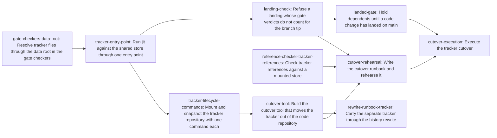

# Plan: Move the tracker data into its own repository (6ba9be17)

> Planning node: aa67438d. Authoritative graph:
> [breakdown.json](breakdown.json).

## Outcome and criterion approach

The tracker becomes an independent git repository checked out at `.jit/` of
the primary checkout. The code repository ignores that path. Every checkout
on the host reads and writes the one store, so tracker state stops being
branch content.

| Criterion | Approach | Evidence / open gap |
|---|---|---|
| REQ-01 | The cutover commit removes the tracker paths from the index, ignores `/.jit/` and forbids tracked paths under it in the budget configuration | F-01, D-08 |
| REQ-02 | The tracker repository is extracted with the history of its paths and mounted unedited; equality is the git tree identifier of `.jit` against the new head tree | D-10 |
| REQ-03 | One entry point resolves the store, the code root and the agent identity from git; the cutover observes a gate from a linked worktree | `tracker-root-resolution`, F-02, F-04, F-07 |
| REQ-04 | A landing check counts each required gate verdict for the branch tip: the executed run records the tip, or the gate's declared inputs are identical at both commits; a `landed` gate holds dependents until the merge | `landing-link`, D-05, D-14, F-03, F-08, F-24, F-28, F-29 |
| REQ-05 | Invariant identifiers resolve from the projection in `AGENTS.md`; tracker paths resolve against a mounted store; branch-only documents resolve through the git objects all checkouts share | `tracker-reference-resolution`, F-11, F-12, F-27 |
| REQ-06 | Gate checkers and repository scripts read the data root, isolate their scratch render from an inherited environment and write logs under `target/`; skill scripts, outside the repository, run against the primary checkout | D-11, F-09, F-14, F-15, F-23, F-25 |
| REQ-07 | A snapshot command commits under jit's write lock | `tracker-snapshot-discipline`, F-10, D-12 |
| REQ-08 | A mount command clones the tracker into place and validates it; the cutover checks a fresh clone with and without it | D-09, D-13 |
| REQ-09 | A tool and a runbook, rehearsed with rollback on a scratch clone | `cutover-sequence`, `rewrite-tracker-handoff` |
| REQ-10 | The cutover commit carries the layout statements and the lower tree limit | D-08 |

## Shared architectural contracts

### `tracker-root-resolution` [plan-fixed] — store, code root and identity

The data root is `JIT_DATA_DIR` when set, otherwise `.jit` under the top
level of the current checkout; every checker and repository script reads store
files through it. The entry point sets `JIT_DATA_DIR` to `.jit` under the
primary checkout, the parent of the absolute git common directory, and
`JIT_WORKTREE_ROOT` to the top level of the invoking checkout. It keeps a
`JIT_AGENT_ID` the caller set, and otherwise derives `agent:<directory name>`
from the name git registers a linked worktree under; the primary checkout
uses jit's configured agent. It refuses a linked worktree that holds a store of
its own: before the cutover that is the worktree's tracked store, used with
plain jit, and after it a stale copy. The store's configuration sets
`[worktree] root = ".."`, so plain jit is correct in the primary checkout. In
a linked worktree plain jit finds no store and fails (F-05). jit passes its
environment to checkers (F-23), so a checker that starts jit in a scratch
copy sets both variables for that copy. A linked worktree carries no `.jit`
mount, so a skill script that requires `.jit` under the root it is given runs
against the primary checkout (F-25).

### `landing-link` [plan-fixed] — what ties a landed change to its issue

A code commit names its issue in its subject scope, the existing commit rule.
A gate-run record names the commit and branch its checker ran at (F-03); a
reused verdict names the run that executed the checker (F-24). A verdict
counts for the commit its executed run records, and for another commit when
git reports no difference between the two over the gate's declared input
roots less its exclusions (F-29). The landing check passes when each required
automated gate passed and its verdict counts for the branch tip; otherwise the
lead forces that gate at the tip. A manual gate is judged by its attestation
and a gate with a built-in checker by its pass: those judge the store and
record no commit. A branch lands in this order: gates evaluated at the tip
through the entry point, the landing check, the merge, the merged-tree gate, a
snapshot, the `landed` gate. jit moves an issue to done and promotes its
dependents when its last gate passes (F-28). A code-producing issue, one that
requires `cargo-ci`, also requires the automated `landed` gate. It judges the
gates whose checker is an executed command, the class whose verdict the
landing check counts by commit: it passes when the commit each one's executed
run records is an ancestor of `main`, so done and promotion wait for the
merge. Manual and built-in gates record no commit and impose no condition; an
executed-command gate whose run records none fails it, and an issue with no
executed-command gate passes it. The landing check skips it. The rule binds
from the cutover: while the code repository tracks the store, recording a verdict moves
the tip. Issue state and code are consistent at each landing and are no longer
one atomic merge; between landings the store is ahead of `main` by the work in
progress.

### `tracker-snapshot-discipline` [plan-fixed] — commits of the tracker repository

jit commits nothing (F-10). The snapshot command stages and commits the store
under jit's write lock; the lock is its consistency condition. Repository validation does not gate it,
because an unpinned link to a branch-only document fails validation in every
other checkout. A lead runs it after each landing and the steward at the end
of a session; it is a no-op on a clean store, so any agent may run it. Tracker
commits are snapshots: the commit subject rule and the tree budget of the code
repository do not bind them. The store has one writable checkout, on this
host, so it needs no merge attribute. It is local (D-12): a fresh clone on
this host mounts it from its path. The store's own ignore file names the
machine-local files.

### `tracker-reference-resolution` [plan-fixed] — references across the two repositories

`@/inv/<id>` resolves against the invariant projection in `AGENTS.md`, which
the code repository tracks (F-18). A path under `.jit/` named in tracked text
is a tracker reference. The checker finds the store through the data root.
With the store mounted a tracker reference must name a tracked or untracked
unignored file of the git repository that contains the data root, or a path
that repository ignores; that rule is the same before and after the cutover.
Without the store the checker reports the count it left unchecked.
`@/issue/<id>` stays with the docs-mechanical gate, which needs jit (F-13).
Issue prose is checked where the store sits under the checkout being checked,
which after the cutover is the primary checkout, under the exception entries
for issue prose and archive records; a linked worktree shares the store with
other branches and skips it. There a document link pinned to a commit resolves
in that commit's tree, and an unpinned link or a path named in issue prose
resolves in the checkout or in the tree of a local branch head. All checkouts
of the host share the git objects and branch references, so a document that
exists only on another session's branch resolves (F-27). Such a document is
linked pinned to a branch commit and re-linked unpinned when it lands (D-13).
GitHub runners have no store and check everything else.

### `cutover-sequence` [plan-fixed] — order of the cutover

1. Quiesce, in a quiet window of its own: no tracker writer,
   no pending redo record, every lease released, each surviving branch's
   branch-only tracker edits ported into `main`'s store by tracker commits
   or recorded as abandoned, gate-run holders listed. Before the window, each branch of a
   done issue whose content is on `main` is abandoned on the owner's reviewed
   list: its ref moves to `refs/archive/<name>`.
2. Save the ref listing (`git for-each-ref`) and archive the store of every
   linked worktree.
3. Extract the tracker paths with their history into a new repository; require
   equal tree identifiers.
4. Mount: commit the code-side change, replace `.jit/` of the primary
   checkout with a clone of the new repository, restore the machine-local
   files.
5. Harvest each worktree's run records into the shared store; a run record
   present with different bytes stops the harvest, and a differing verdict
   pointer keeps the store's.
6. Verify: repository validation, issue count, a gate from a linked worktree
   created at the cutover commit, two agent identities, both checkers with
   and without the store, a fresh clone. Then snapshot.
7. Clean each surviving branch and worktree with one commit whose tree is
   the branch tip's tree without `.jit`, merging nothing, so the clean cannot
   conflict, the code tree is unchanged and `git ls-files .jit` is empty on
   `main` and on each live branch; the branch merges `main` when it resumes.
   Delete the local store once its harvest is verified. Step 1 ported or
   abandoned any branch-only tracker content first.
8. Roll back on a failed step 6 or 7 through git: refs back to the step-2
   listing with `git update-ref`, `main` back to its pre-cutover commit, the
   mounted clone removed and the tracked `.jit` checked out; the cutover is
   retried in a later window. The tool is the forward path only: a step that
   meets an unexpected state stops with a message and changes nothing, and
   no step writes, resets or removes a working-tree file outside `.jit/`
   (owner order 2026-11-16).
9. Snapshot and release the window; the history rewrite later starts from
   this state.

### `rewrite-tracker-handoff` [plan-fixed] — the history rewrite after the cutover

The history rewrite of `@/issue/45ecf975` runs later, in a quiet window of its
own, against the separated tracker. Its path filter drops `.jit` and every path
under it from every commit. Its pin mapper reads issue records through the
data root and runs against the tracker mounted in the rewritten checkout; the
remapped pins are a tracker commit. Its rehearsal and validation step mount
the tracker before repository validation. Its backup bundles the tracker
repository, and its reseating keeps the primary checkout's tracker repository
with the remapped pins. The rewrite rehearsal runs on a scratch clone of a
repository after a rehearsed cutover. Task `rewrite-runbook-tracker` carries
the rewrite side and keeps the runbook (F-20, F-26).

## Generated decomposition overview

<!-- jit:breakdown-overview:begin -->
| Key | Title | Type | Outcome | Contracts | Sources | Footprint | Landing | Depends on |
|---|---|---|---|---|---|---|---|---|
| gate-checkers-data-root | Resolve tracker files through the data root in the gate checkers | task | Gate checkers read the store through the data root and write nothing under a code checkout's store path | tracker-root-resolution | REQ-06, D-04, D-07, F-09, F-14, F-15, F-16, F-23 | touches 9 | — | — |
| tracker-entry-point | Run jit against the shared store through one entry point | task | One script gives each checkout the shared store with its own code root | tracker-root-resolution | REQ-03, D-04, F-02, F-04, F-05, F-07, F-21, F-23 | creates 2, touches 2 | — | gate-checkers-data-root |
| landing-check | Refuse a landing whose gate verdicts do not count for the branch tip | task | A landing is refused unless each required gate verdict counts for the branch tip | landing-link | REQ-04, D-05, F-03, F-04, F-08, F-24, F-29 | creates 1, touches 1 | — | tracker-entry-point |
| landed-gate | Hold dependents until a code change has landed on main | task | An issue reaches done and promotes its dependents only once its code is on main | landing-link, tracker-root-resolution | REQ-04, D-14, F-03, F-24, F-28 | creates 2, touches 3 | — | landing-check |
| reference-checker-tracker-references | Check tracker references against a mounted store | task | The reference checker passes without the tracker and checks tracker references and branch-only document links when it is mounted | tracker-reference-resolution, tracker-root-resolution | REQ-05, REQ-06, D-03, F-11, F-12, F-17, F-18, F-22, F-27 | touches 1 | — | — |
| tracker-lifecycle-commands | Mount and snapshot the tracker repository with one command each | task | A fresh clone mounts the tracker with one command and the store is snapshotted with another | tracker-root-resolution, tracker-snapshot-discipline | REQ-07, REQ-08, D-06, D-09, F-09, F-10 | creates 2, touches 3 | — | tracker-entry-point |
| cutover-tool | Build the cutover tool that moves the tracker out of the code repository | task | One tool carries the tracker and each worktree's tracker state through the cutover and back | cutover-sequence, tracker-root-resolution | REQ-02, REQ-09, D-01, D-07, D-08, F-01, F-06, F-07, F-09, F-19 | creates 1 | — | tracker-lifecycle-commands |
| rewrite-runbook-tracker | Carry the separate tracker through the history rewrite | task | The history rewrite drops the tracker paths and keeps the separate tracker valid through reseating | rewrite-tracker-handoff, tracker-root-resolution | REQ-09, D-10, F-20, F-26 | touches 3 | — | cutover-tool |
| cutover-rehearsal | Write the cutover runbook and rehearse it | task | A runbook rehearsed end to end carries the tracker through the cutover and back | cutover-sequence, rewrite-tracker-handoff, tracker-root-resolution, tracker-reference-resolution | REQ-09, D-01, D-07, D-10, F-05, F-07, F-20, F-27 | creates 1 | — | landing-check, reference-checker-tracker-references, cutover-tool |
| cutover-execution | Execute the tracker cutover | task | The live repository runs on the separate tracker with no tracked or stale store left | cutover-sequence, rewrite-tracker-handoff, landing-link, tracker-snapshot-discipline, tracker-reference-resolution | REQ-01, REQ-02, REQ-03, REQ-07, REQ-08, REQ-09, REQ-10, D-01, D-02, D-03, D-05, D-06, D-08, D-09, D-10, F-01, F-16, F-19, F-20, D-13, D-14 | touches 10 | — | cutover-rehearsal, landed-gate |

<!-- jit:breakdown-overview:end -->

## Material risks and owner decisions

| Risk / decision | Resolution and rationale |
|---|---|
| D-01 Layout | Chosen by the owner on 2026-11-14: an independent repository mounted at `.jit/`. Rejected: a submodule, which needs a gitlink commit per tracker operation and conflicts on gitlinks across worktrees; an orphan branch with its own worktree and a subtree, which keep tracker objects and commits in the code repository; staying in-tree with `.jit/` excluded from the budget, kept only as the interim measure until the cutover. |
| D-02 Declarations | The whole store moves, including invariants, configuration, templates, rules and gate definitions: jit reads them from the data root only. The code repository keeps the invariant projection in `AGENTS.md`, so a change to an invariant still appears as a reviewed code commit. Rejected: links from the store into the code repository, which jit's root rules do not support. |
| D-03 References | See `tracker-reference-resolution`. The owner decided on 2026-11-14 that `@/inv/resolvable-references` reads: "Tracked text names only what a fresh clone resolves, alone or with the tracker checkout mounted at `.jit/`: no host-local path and no repository path that does not exist." The cutover commits it before the extraction. Rejected: a tracked index of issue identifiers, which restores the churn this epic removes. |
| D-04 Environment | See `tracker-root-resolution`. Guards against the gate that records the wrong commit: plain jit fails in a linked worktree, the entry point never sets the store without the code root and refuses a stale local store, and the landing check refuses a verdict that does not count for the tip. Rejected: exporting the variables in each dispatch prompt, which every new dispatch path would have to repeat; a `.jit` symlink in each linked worktree, whose discovery and code-root resolution through a symlink jit does not document. |
| D-05 Landing | See `landing-link`. The owner amended epic REQ-04 on 2026-11-14: a verdict counts for the commit it ran on, and for another commit when the gate's declared inputs are identical at both, which saves a forced run after a commit outside the inputs. The comparison uses the input roots and exclusions jit reports for the gate. Rejected: recording code commits in tracker commits or in a ledger, a second copy of what the commit subject and the gate-run record state. |
| D-06 Snapshots | See `tracker-snapshot-discipline`. Explicit snapshots tie each tracker commit to a landing and to the `main` commit its subject names. Rejected: a commit per jit mutation, which contends for the tracker's index across concurrent agents; a timer, which ties no commit to a landing and is one more process each quiet window must stop. |
| D-07 Gate runs | One shared, uncommitted `gate-runs/` directory replaces the copying between worktrees. The records hold 46 MB of checker output on this host and are execution records under `@/inv/committed-evidence-budget`; the cutover harvests each worktree's records into the store. Kani logs move to `target/`. |
| D-08 Budgets | The code repository forbids tracked paths under `.jit/`, drops the tracker exceptions the mounted check does not read and lowers the tree limit to the measured size. The tracker repository has no size budget: it is the record. Its event log grows without bound: the jit project does not plan request U-5. |
| D-09 Bootstrap | The mount command takes the tracker repository's path or URL as its argument; a fresh clone on this host names the path. Without the tracker a clone builds, tests and passes CI; only jit is unavailable. |
| D-10 Timing | The owner decided on 2026-11-15, superseding the decision of 2026-11-14: the cutover runs alone in a quiet window of its own, before the history rewrite, and cleans every parked branch. The cleaning rule is charter D-12 (owner, 2026-11-15, superseding the merge of `main`): a branch of a done issue whose content is on `main` is abandoned to `refs/archive/<name>` before the window; every surviving branch, those without an issue included, gets one commit that removes its tracked `.jit/` paths and merges `main` when it resumes. A removal-only branch checked out in the primary checkout shows the mounted tracker as untracked until it merges `main`. The rewrite runs later against the separated tracker and drops the tracker paths from history (`rewrite-tracker-handoff`). Accepted cost: branches settle twice, at the cutover and at the rewrite. Rejected: after the rewrite, which keeps the tracker paths in history until a second rewrite. External edge for breakdown: `@/issue/45ecf975`, which runs the rewrite, depends on `cutover-execution`. |
| D-11 Script scope | The owner narrowed epic REQ-06 on 2026-11-14 to the scripts under `scripts/`, `contrib/gates/` and `dev/scripts/`. The jit skills and their scripts live in the user-level skill directory, outside the repository; they work through the `.jit/` mount of the checkout they run in, which after the cutover is the primary checkout only. No manifest task changes them. |
| D-12 Local tracker | The owner decided on 2026-11-14 that the tracker repository is local. Pushing is an owner action outside the plan, and no criterion orders it. |
| D-13 Branch documents | The owner decided on 2026-11-14: a document that exists only on a branch is linked pinned to a branch commit and re-linked unpinned when it lands. jit resolves the pin from the git objects every checkout shares, so validation passes in the primary checkout and in a clone of the host's repository; an unpinned branch-only link fails validation in the primary checkout at once. Rejected: linking documents only from `main`, which stops planning on a branch from linking its artifacts; amending REQ-08. |
| D-14 Landed gate | The owner decided on 2026-11-14: a required automated `landed` gate on code-producing issues, evaluated after the merged-tree gate and skipped by the landing check, judges the executed-command gates and holds done and the promotion of dependents until the merge; a `code-task` gate preset bundles it. The repository held no gate preset. Rejected: a dispatch query that waits for each dependency's landing, which every dispatch path would have to use; recording the last gate after the merge, which nothing enforces. The gate is permanent: the jit project declines U-9 and documents this landing-gate pattern. |
| RISK-01 Shared identity | Checkouts sharing the store share one worktree identity (F-07); a lease is attributed by agent identity alone. The entry point derives a distinct identity per checkout; the entry point stays until jit v1.1 ships U-4. |
| RISK-02 Unverified jit behaviour | F-04, F-05, F-07, F-27 and the resolution of the worktree root for a nested repository rest on documentation, source and one experiment. The rehearsal re-checks them and records any contradiction before the runbook changes. The forward rehearsal of 2026-11-16 falsified F-05: plain jit in a linked worktree resolves the primary checkout's store through the git common directory; linked worktrees use the entry point (recorded in `@/issue/6889e6e6`). |
| RISK-03 Skill scripts | The jit skills live in the user-level skill directory and name jit without the entry point (F-21, F-25, F-30). The standards scanner and fixer of the project-lead skill take the project root as their argument, require `.jit` under it, read the configuration and the documents from it and run jit there. Run from a linked worktree after the cutover they exit 2 naming the missing `.jit`; given the primary checkout as root, from any directory, they sweep the primary checkout's documents and the shared store. The worker dispatch script resolves the store through jit, so it works through the entry point; the manifest helper of the planning-lead skill takes the configuration path under the data root through its `--config` option. The landing script of the execution-lead skill commits `.jit` in the code repository and refuses a set `JIT_DATA_DIR`, so it stops working at the cutover; leads land with the landing check, the merge and the snapshot command instead. `AGENTS.md`, which every agent loads, states this. The rule stays until jit v1.1 ships U-7 and the skill fixes. |
| RISK-04 Concurrent store | All sessions now write one store. jit serializes writers with its store lock; a tracker change is visible to every lead at once, without review by merge. |
| RISK-05 Document links | jit resolves an unpinned document link in the invoking checkout and a pinned one at its commit in the code repository's objects (F-27). A clone holds a pinned commit when it is cloned from the host's repository, which holds every branch. The rehearsal checks both cases in the primary checkout; the pinning rule stays until jit v1.1 ships U-8. |

### Requests to the jit project

Separate from the plan; nothing above depends on them. The jit project plans
U-1 to U-4 and U-6 to U-8, with the skill fixes, for jit v1.1, its
separate-store layout; each local workaround above stays until that release
ships. It does not plan U-5 and declines U-9.

- U-1: Discover the store of the primary checkout from a linked worktree and
  use the invoking checkout as code root. Retires the entry point.
- U-2: Refuse a gate evaluation whose invocation directory lies in a checkout
  other than the resolved code root.
- U-3: Report the code root in `jit worktree info`.
- U-4: Keep a worktree identity per checkout for a nested independent store.
- U-5: Rotate or compact the event log. Not planned upstream.
- U-6: Commit the data repository after a mutation, or run a configured hook.
- U-7: Have the dispatch scripts and the path-reading skill scripts take the
  tracker environment.
- U-8: Validate the store without resolving document links, or resolve them
  across the branches of the code repository.
- U-9: Hold the promotion of dependents until a configured landing condition
  holds. Declined upstream.

## Investigation sources

- [Investigation](investigation.md): findings F-01 to F-30, the consumers of
  tracker paths and the facts not verified.
