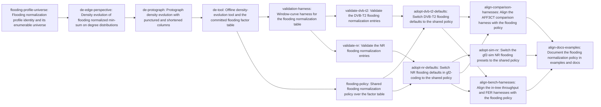

# Plan: Choose the flooding min-sum normalization per code family (3461a52a)

The flooding normalized min-sum (NMS) factor follows the code: a generated,
caller-overridable table of density-evolution-optimal factors per code profile
and iteration cap, adopted per family once benchmark-window curves confirm it.

> Planning record: @/issue/3461a52a. Authoritative graph:
> [3461a52a-breakdown.json](3461a52a-breakdown.json). REQ-01 inventory:
> [inventory-3461a52a.md](inventory-3461a52a.md).

## Decision

For @/issue/3461a52a, the flooding NMS factor follows the code. The structural rule is a table of the density-evolution-optimal factor per code, rate and iteration cap. An in-tree offline tool produces the table from DVB-T2 edge-perspective degree distributions and NR BG1/BG2 protographs with punctured columns. Defaults read the table; callers override them.

A graph with no table entry keeps its current behaviour: generic `LdpcDecoder::new` uses plain min-sum; NR rate-matched constructors and explicitly selected NMS defaults retain 0.75 unless the caller passes a factor. No unmeasured profile inherits a family constant.

The rule stands if benchmark-window curves confirm it. A curve that contradicts a table entry is recorded as a falsification in this issue; the entry is revised or the rule rejected with the data. The issue stays open until the rule is established or rejected. @/issue/d5cd53e0 supplies indications; @/issue/259acf37 supplies the existing window basis.

## Outcome and criterion approach

| Criterion | Approach | Evidence / open gap |
|---|---|---|
| REQ-01 | A separate inventory document lists each site and the codes it serves, and classifies it under `inventory-classification`; alignment leaves consume it | [Inventory](inventory-3461a52a.md) |
| REQ-02 | Decision above; measured basis and DE estimate below; the rule's universe, configuration and confirmation are the contracts `flooding-profile`, `de-configuration` and `validation-decision-rule` | Owner decisions of 2026-11-14 in @/issue/3461a52a |
| REQ-03 | The manifest names the follow-up work as proposed issues; the lead files them, and no code changes precede them | [Manifest](3461a52a-breakdown.json) |

The inventory is a separate linked document because the gate treats an
exhaustive file inventory in the plan as accumulation, and the planning-lead
contract places consumer and file inventories in a document the plan cites.

## Shared architectural contracts

### `flooding-profile` [implementation-produced] — profile identity and universe

`FloodingProfile` is the one semantic identity (@/inv/semantic-types) of a code
for flooding normalization. A DVB-T2 profile is a (frame size, code rate) pair
that `LdpcCode::dvb_t2_short` or `LdpcCode::dvb_t2_normal` in
`crates/gf2-coding/src/ldpc/core.rs` builds from
`crates/gf2-coding/src/ldpc/dvb_t2/dvb_t2_matrices.rs`. An NR profile is a base
graph with either the full mother code or a rate-matched pattern of filler and
kept-parity base columns derived from `NrRateMatchParams` in
`crates/gf2-coding/src/ldpc/nr_5g/mod.rs`; lifting size is excluded, since
protograph DE is asymptotic in it. The NR universe is what
`QuasiCyclicLdpc::nr_5g_rate_matched` reaches over the base-graph dimensions in
`crates/gf2-coding/src/ldpc/nr_5g/bg1.rs` and
`crates/gf2-coding/src/ldpc/nr_5g/bg2.rs`, `kb_for_z_selection` and
`crates/gf2-coding/src/ldpc/nr_5g/lifting.rs`. The cap universe is the library's
flooding default caps: `SOFT_DECODE_MAX_ITERATIONS` in
`crates/gf2-coding/src/ldpc/nr_5g/mod.rs` and the DVB-T2 concatenated decoder's
default cap in `crates/gf2-coding/src/ldpc/dvb_t2/concat.rs`, which the producer
names. One library function enumerates both universes; table generation,
validation sampling and lookup read it, and its size is derived, never stated
(@/inv/single-source-prose). Producer: `flooding-profile-universe`.

### `density-evolution-api` [implementation-produced] — edge-perspective DE

A `gf2-coding` API returning the flooding NMS DE threshold of a degree
distribution at a factor and cap, and the threshold-optimal factor over the
configured grid. Producer: `de-edge-perspective`.

### `protograph-de` [implementation-produced] — protograph DE

The same API over a base graph with punctured columns at zero channel
information and filler columns as known bits. Producer: `de-protograph`.

### `flooding-nms-table` [implementation-produced] — generated factor table

`FLOODING_NMS_FACTORS`, a generated `gf2-coding` source file keyed by
(`FloodingProfile`, cap), one entry per enumerated pair, its configuration in
the file header. The offline `ldpc-density-evolution` tool under `dev/tools/`
regenerates it; raw DE samples stay outside the tree. Producer: `de-tool`.

### `flooding-nms-policy` [implementation-produced] — shared lookup

One caller-overridable policy resolves a flooding decode's factor from the
code's profile and the actual cap, at the point the cap is known
(`decode_iterative` in `crates/gf2-coding/src/ldpc/core.rs`). An explicit
algorithm or factor wins; a pair without an entry takes the Decision's
absent-entry behaviour. Producer: `flooding-policy`.

### `de-configuration` [plan-fixed] — DE configuration

Every DE run declares seed, sample count, factor grid, threshold precision,
stopping rule and cap. Fixed values: seed 3461; BPSK AWGN with the all-zero
codeword; a factor grid no coarser than 0.025 over $[0.5, 1.0]$; threshold
bisection stopping at 0.05 dB for DVB-T2 and 0.1 dB for NR, the precisions of
the estimate below.

### `validation-decision-rule` [plan-fixed] — pre-registered confirmation rule

Sample: every DVB-T2 profile, and per NR base graph the mother code and the
rate-matched profiles at the lowest, median and highest rate of the universe,
each at its library default cap. Candidates: the table factor $\alpha^*$,
$\alpha^* \pm 0.05$, 0.75, plain min-sum where it is the current default, and 0.875 for DVB-T2. Each FER point
runs to 100 frame errors or 200 000 frames, BPSK AWGN, seed 3461, random
codewords, syndrome stop. The FER $10^{-3}$ crossing is log-linear
interpolation on a 0.05 dB grid, with an interval from 95% Wilson bounds on the
bracketing points. An entry is confirmed when the crossing of $\alpha^*$ is
within 0.05 dB of the best candidate's; falsified when a candidate is better by
more than 0.05 dB with non-overlapping intervals; otherwise unconfirmed. The
rule stands for a family when each sampled entry is confirmed. A falsified
entry is recorded, regenerated with its DE configuration corrected and measured
once more; a second falsification rejects the rule for that family, and that
family's defaults stay as they are.

### `inventory-classification` [plan-fixed] — consumer or fixture

The classification section of the [inventory](inventory-3461a52a.md) decides
which sites consume the policy; explicit fixtures keep their named factors so
historical evidence and contradictions stay interpretable.

## Generated decomposition overview

<!-- jit:breakdown-overview:begin -->
| Key | Title | Type | Outcome | Contracts | Sources | Footprint | Landing | Depends on |
|---|---|---|---|---|---|---|---|---|
| flooding-profile-universe | Flooding normalization profile identity and its enumerable universe | task | Standard LDPC codes carry a canonical flooding profile drawn from one enumerated universe | — | REQ-02, D-RULE | creates 1, touches 4 | density-evolution | — |
| de-edge-perspective | Density evolution of flooding normalized min-sum on degree distributions | task | Flooding NMS density evolution on degree distributions is a deterministic gf2-coding API | flooding-profile, de-configuration | REQ-02, D-RULE, D-ORDER, DE-EST, F-ZHANG | creates 2 | density-evolution | flooding-profile-universe |
| de-protograph | Protograph density evolution with punctured and shortened columns | task | Flooding NMS protograph density evolution covers NR mother and rate-matched profiles | flooding-profile, density-evolution-api, de-configuration | REQ-02, D-RULE, DE-EST | creates 1, touches 1 | density-evolution | de-edge-perspective |
| de-tool | Offline density-evolution tool and the committed flooding factor table | task | One offline command regenerates the committed flooding factor table from the universe | flooding-profile, density-evolution-api, protograph-de, de-configuration | REQ-02, D-RULE, DE-EST, F-ZHANG | creates 3, touches 2 | density-evolution | de-protograph |
| validation-harness | Window-curve harness for the flooding normalization table | task | A resumable harness applies the pre-registered rule to sampled flooding profiles | flooding-profile, flooding-nms-table, validation-decision-rule | REQ-02, D-RULE, D-ORDER | creates 3 | validation | de-tool |
| validate-dvb-t2 | Validate the DVB-T2 flooding normalization entries | simulation | Window curves decide whether the flooding table stands for DVB-T2 | validation-decision-rule, flooding-nms-table | REQ-02, D-RULE, D-ORDER, W-259, IND-D5 | touches 1 | validation | validation-harness |
| validate-nr | Validate the NR flooding normalization entries | simulation | Window curves decide whether the flooding table stands for NR | validation-decision-rule, flooding-nms-table | REQ-02, D-RULE, D-ORDER, W-259, IND-D5 | touches 1 | validation | validation-harness |
| flooding-policy | Shared flooding normalization policy over the factor table | task | One caller-overridable policy resolves the flooding factor from profile and actual cap | flooding-profile, flooding-nms-table | REQ-02, D-RULE | creates 1, touches 2, uncertain | adoption | de-tool |
| adopt-dvb-t2-defaults | Switch DVB-T2 flooding defaults to the shared policy | task | Default DVB-T2 flooding decodes take the validated table factor | flooding-nms-policy, inventory-classification | REQ-01, INVENTORY, D-RULE | touches 2, uncertain | adoption | flooding-policy, validate-dvb-t2 |
| adopt-nr-defaults | Switch NR flooding defaults in gf2-coding to the shared policy | task | Default NR flooding decodes in gf2-coding take the validated table factor | flooding-nms-policy, inventory-classification | REQ-01, INVENTORY, D-RULE | touches 3 | adoption | flooding-policy, validate-nr |
| adopt-sim-nr | Switch the gf2-sim NR flooding presets to the shared policy | task | gf2-sim NR presets decode with the library's flooding default | flooding-nms-policy, inventory-classification | REQ-01, INVENTORY | touches 2 | adoption | adopt-nr-defaults |
| align-comparison-harnesses | Align the AFF3CT comparison harness with the flooding policy | task | The AFF3CT comparison harness runs and reports the policy's flooding factor | flooding-nms-policy, inventory-classification | REQ-01, INVENTORY | touches 7 | alignment | adopt-dvb-t2-defaults, adopt-nr-defaults |
| align-bench-harnesses | Align the in-tree throughput and FER harnesses with the flooding policy | task | In-tree throughput and FER harnesses measure at the policy's flooding factor | flooding-nms-policy, inventory-classification | REQ-01, INVENTORY | touches 3 | alignment | adopt-dvb-t2-defaults, adopt-nr-defaults |
| align-docs-examples | Document the flooding normalization policy in examples and docs | task | Examples and docs cite the flooding policy as the factor source | flooding-nms-policy, inventory-classification | REQ-01, INVENTORY | touches 4 | alignment | adopt-sim-nr, align-comparison-harnesses, align-bench-harnesses |

<!-- jit:breakdown-overview:end -->

## Measured basis (REQ-02)

**Indication.** Source: @/issue/d5cd53e0 rework-1 REQ-01 and REQ-02, reviews passed. Host fraktaali (5900X), 2026-11-13, CPUs 8 to 11, four workers, shared unattributed load. Harness `experiments/aff3ct-ldpc-gaps/dvb-t2-r12-diagnosis.sh`, which runs `experiments/aff3ct-ldpc-gaps/src/bin/dvb_t2_fer_diag.rs` and AFF3CT 4.7.0. Configuration: DVB-T2 normal 1/2, BPSK AWGN, natural-log LLRs, iteration cap 50, syndrome stop. At 0.75, gf2/AFF3CT FER is 0.1376/0.1345 at 1.5 dB and 0.009650/0.01005 at 2.0 dB, with about 20 000 frames per arm and overlapping 95% Wilson intervals. At 0.875, FER is 0.8456/0.8571 at 1.0 dB, then no errors observed at 1.2 and 1.5 dB over about 5 000 frames per arm, so the 95% upper bound is 7.7e-4 and the FER is not shown to be zero. Counts and seeds are in the cited script. A cap of 200 leaves 0.75 stuck, so gf2's flooding implementation is not shown to be defective.

**Layered configuration.** `LayeredConfig::dvb_t2` uses 7/8 and `LayeredConfig::nr_5g` uses 6/8 in `crates/gf2-coding/src/ldpc/layered.rs`; these are the comparator settings of the window results.

**Window results.** Source: @/issue/259acf37, 2026-11-14, host fraktaali (5900X, 24 threads), full host. Harness `crates/gf2-coding/tests/ldpc_layered_fer.rs`: random-codeword BPSK AWGN, flooding cap 50 and layered cap 25, syndrome stop, up to 200 000 frames per point, stopping once both decoders reach 100 errors, 0.1 dB grid. Log-linear crossings of FER 1e-3: DVB-T2 normal 1/2 at 0.875 crosses at 1.177 dB (grid 0.8 to 2.8 dB); NR BG1 Z=384 mother code at 0.75 crosses at 0.691 dB (grid 0 to 1.5 dB). Whether 0.75 is optimal for NR is unknown. No NR factor comparison exists.

**Estimate.** Source: @/issue/3461a52a, density-evolution estimate (2026-11-14). Sample-based density evolution (DE) of flooding NMS uses BPSK AWGN, the all-zero codeword and a single seed; precision is about 0.05 dB for DVB-T2 and 0.1 dB for NR. These are estimates, not window results.

|Code / rate|Estimated threshold-optimal factor|
|---|---|
|DVB-T2 normal 1/2, cap 50|about 0.90; 0.75 costs about 1.1 dB|
|DVB-T2 short 1/2|at least 0.95|
|NR BG1 and BG2, low and middle rates|0.6 to 0.7|
|NR rates 0.77 to 0.88|0.75 to 0.80|

DVB-T2 needs its edge-perspective degree distribution; NR needs protograph DE with punctured columns. The optimum depends on rate and iteration cap.

Sources: J. Zhang, M. Fossorier, D. Gu and J. Zhang (GLOBECOM 2005, doi:10.1109/glocom.2005.1577841), whose factor search minimizes the DE threshold; A. A. Emran and M. Elsabrouty (arXiv:1501.07336); J. Chen and M. P. C. Fossorier (IEEE Commun. Lett. 2002, doi:10.1109/4234.1001666), the method's origin, cited from metadata only because its body is not read.

**Falsification candidate.** Zhang et al. report 0.75 for the (16200, 7200) code with a 0.90 dB threshold; the estimate gives at least 0.95 and 2.72 dB at 0.75; Emran et al. report 0.9375. The contradiction stands until a window curve decides it.

**Falsified and withdrawn claims.**

- The 2026-11-13 window curve for DVB-T2 at 0.75 stays above 1e-3 at 2.0 dB. It is falsified as a reference for the layered-versus-flooding comparison because the two decoders ran under different rules; the ruling and the comparator use 7/8 for DVB-T2 and 6/8 for NR.
- The claim that the DVB-T2 transition is "near 1 dB" has no source. The measured transition at 0.875 spans 1.0 to 1.2 dB.
- @/issue/d5cd53e0 withdraws its matrix-identity claim and its total-range-only claim: independent AFF3CT tables show agreement only in counts, and both the resolution and both message bounds matter.
- The error floor stays open in @/issue/b8157e14; the window ends at 1.2 dB.

**Limits.** Other DVB-T2 rates, short frames, NR BG2, NR RM and unknown graphs have no measured factor comparison. Window curves of the queued DVB-T2 normal 1/2 slice are recorded in @/issue/3461a52a.

## Material risks and owner decisions

| Risk / decision | Resolution and rationale |
|---|---|
| REQ-02 rule form | Owner decision (2026-11-14): a DE-optimal table per code, rate and cap from an in-tree tool, caller-overridable, standing only if window curves confirm it; rejected: one family constant per code family |
| Order of evidence | Owner decision (2026-11-14): literature and DE first, then window curves across DVB-T2 rates and frame sizes and NR BG1 and BG2 |
| DE disagrees with curves | Pre-registered rule decides per entry; falsifications are recorded in @/issue/3461a52a (@/inv/falsification-preserved) |
| Caller cap outside the cap universe | Resolves to the absent-entry behaviour; chosen over interpolating between caps, which DE has not shown to be monotone |
| A family's rule is rejected | Its adoption leaf does not proceed and its defaults stay; the other family proceeds independently |
| NR universe size | Derived from the enumeration; each pair is one offline DE run, and validation samples it under the rule |

## Sources

Manifest `source_refs` use these identifiers: `REQ-01`, `REQ-02`, `REQ-03`
(criteria of @/issue/3461a52a); `D-RULE` and `D-ORDER` (the two owner decisions
above); `DE-EST` (the estimate); `F-ZHANG` (the falsification candidate);
`W-259` (window results); `IND-D5` (indication); `INVENTORY` (the
[inventory](inventory-3461a52a.md)).
